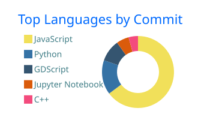

<h1 align="center">Hi, I'm Reza 👋</h1>

  

  
  
  

  Full-stack engineer building AI-powered SaaS products for web and mobile. 
  MSc in Telecommunication Engineering, Politecnico di Milano.

---

### 🛠️ Skills

| | |
|---|---|
| **Languages** |  |
| **Frontend & Mobile** |     |
| **Backend** |     |
| **Databases** |  |
| **AI & Integrations** |     |
| **DevOps & Tools** |    |
| **Game Dev** |  |

### 📊 GitHub stats

  
  

